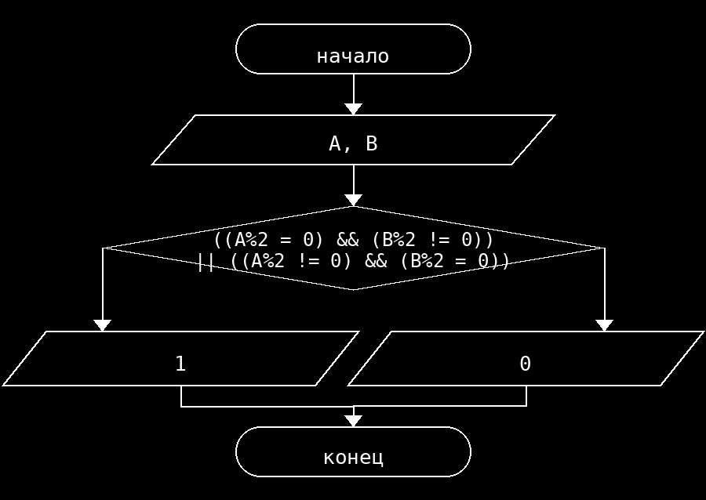

**Условие**
Новый пароль действует, если ровно одно из чисел A и B чётное. Программа выводит 1, когда пароль действует, и 0, когда не действует.

**Блок схема**

**Контрольный пример**
Ввод: 4 7
Вывод: Новый пароль действует: 1

Ввод: 5 8
Вывод: Новый пароль действует: 1

Ввод: 4 8
Вывод: Новый пароль действует: 0

Ввод: 5 9
Вывод: Новый пароль действует: 0
